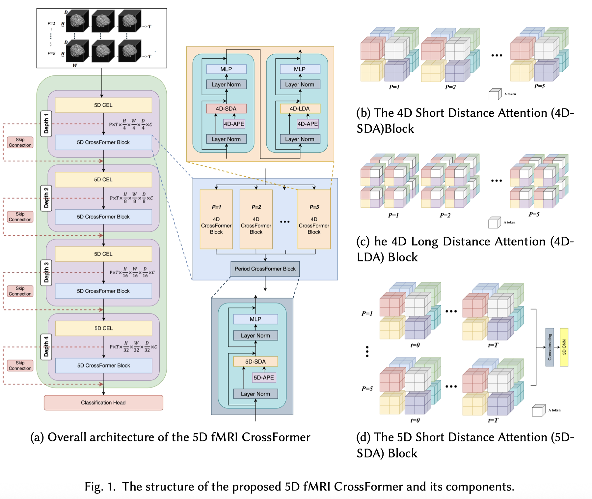
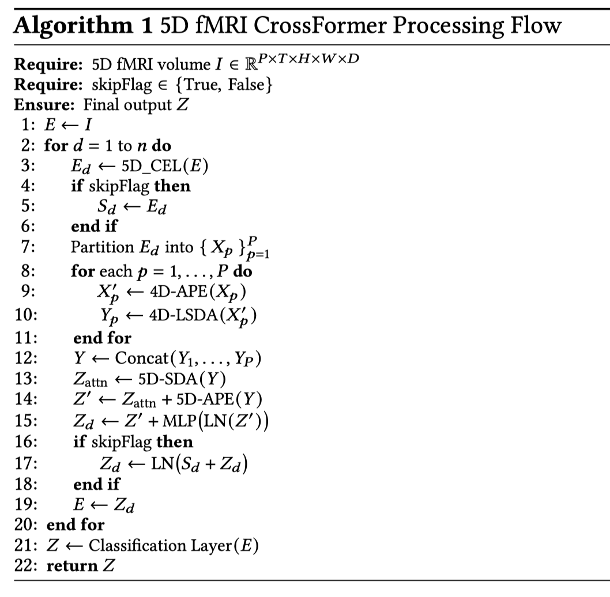
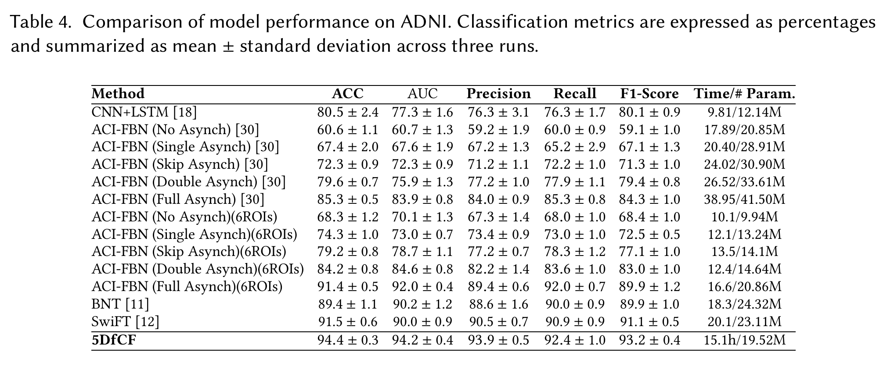
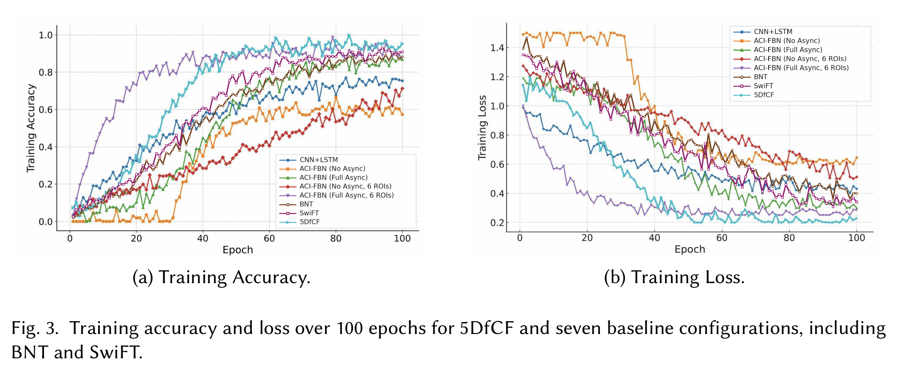
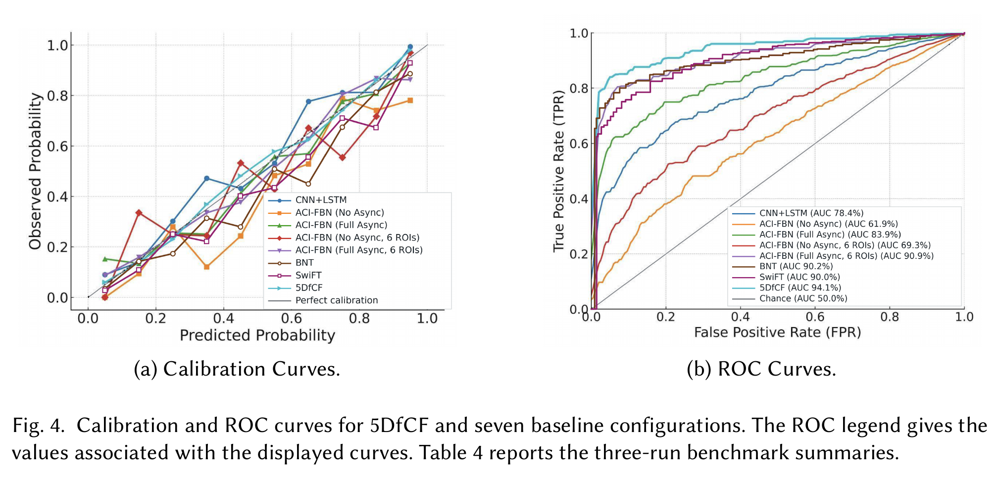

# 5D fMRI CrossFormer for medical analysis (5DfCF)
5D Transformer Architecture for Joint temporal and Spatial Attentions of Timeseries 4D fMRI Images


## Overview

Traditional neuroimaging approaches often treat fMRI volumes as independent time-points, overlooking the rich temporal dynamics present in longitudinal scans. **5D fMRI CrossFormer** introduces a novel five-dimensional architecture that:

- Embeds multi-scale spatial patches across both intra-session and inter-session dimensions.
- Applies dedicated 4D and 5D attention mechanisms to capture both local and global spatiotemporal dependencies.
- Uses period-aware positional embeddings to preserve visit order.
- Offers Base and Tiny backbones, with a LoRA adaptation evaluated for Tiny.

In the longitudinal Alzheimer’s Disease Neuroimaging Initiative (ADNI) benchmark, 5DfCF Base achieved **94.4 ± 0.3% accuracy** and **94.2 ± 0.4% ROC-AUC** across three runs (mean ± standard deviation).

---

## Key Features

- **5D Cross-Scale Embedding Layer (5D-CEL):** Parallel 3D convolutions with multiple kernel sizes embed each fMRI volume into a unified token representation (see Fig. 2).
- **4D CrossFormer Block:** Dual‐path self-attention (4D-SDA for local windows and 4D-LDA for long-range dependencies) combined with absolute positional embeddings ensures rich intra-session feature extraction.
- **Period CrossFormer Block (PCB):** 5D short-distance attention (5D-SDA) fuses period-specific outputs from the 4D blocks, enhanced by period positional embeddings to capture inter-session evolution.
- **Base** uses wider token embeddings and deeper layers. **Tiny** uses a narrower, shallower backbone to reduce training and inference costs.

---

## Figures

### Fig. 1. Model Architecture
  
**Description:**  
The overall structure of the 5D fMRI CrossFormer. Four depths alternate between a **5D Cross-Scale Embedding Layer (5D-CEL)**—which applies parallel 3D convolutions at multiple scales to embed each period–time volume into tokens—and a **5D CrossFormer Block** that fuses period-wise 4D attention with global 5D short-distance attention. Skip-connections carry intermediate embeddings forward, and a final classification head aggregates the last set of tokens into diagnostic predictions.

---

### Fig. 2. Processing Flow (Algorithm 1)
  
**Description:**  
Step-by-step pipeline of the 5D fMRI CrossFormer:
1. **Input** raw 5D volume \(I \in \mathbb{R}^{P\times T\times H\times W\times D}\).
2. For each depth \(d\):
    - **5D-CEL** embeds \(E_{d-1}\) into multi-scale tokens \(E_d\).
    - **Partition** \(E_d\) into period-specific tensors \(\{X_p\}_{p=1}^P\).
    - On each \(X_p\): add 4D absolute positional embeddings (4D-APE), then apply either **4D Short-Distance Attention (4D-SDA)** or **4D Long-Distance Attention (4D-LDA)**.
    - **Concat** period outputs \(\{Y_p\}\), then perform **5D-SDA**, residual MLP with LayerNorm, and optional skip-connection fusion.
3. **Classification layer** transforms the final embedding into output logits \(Z\).

---

### Fig. 3. ADNI Benchmark (Paper Table 4)



5DfCF Base had the highest mean on all five reported classification metrics, including **93.9 ± 0.5% precision**, **92.4 ± 1.0% recall**, and **93.2 ± 0.4% F1**. Its mean accuracy was **2.9 percentage points** higher than SwiFT's, and its mean ROC-AUC was **2.2 points** higher than that of six-ROI Full Asynch ACI-FBN. BNT achieved 89.4 ± 1.1% accuracy and 90.2 ± 1.2% ROC-AUC.

---

### Fig. 4. Training Accuracy and Loss (Paper Fig. 3)

The plots cover 100 epochs and include BNT and SwiFT.



- **(a) Training accuracy.** The six-ROI Full Asynch ACI-FBN curve rises earlier. The 5DfCF curve reaches about 90% around epoch 50 and stays near 95% toward the end. BNT and SwiFT finish at 88.4% and 90.9%, respectively.
- **(b) Training loss.** The 5DfCF curve ends near 0.23, compared with 0.40 for BNT and 0.34 for SwiFT. Fig. 3 reports classification results on held-out participants.

---

### Fig. 5. Calibration and ROC Curves



This figure shows the earlier six-method comparison. The ROC legend gives 94.1% AUC for the displayed 5DfCF curve. The three-run benchmark is summarized in Fig. 3.

---

## Additional ADNI Results

- At held-out ADNI site 137, 5DfCF and SwiFT each correctly classified **10 of 11 participants (90.9%)**. After one observed visit per participant was removed, 5DfCF still classified 10 of 11 correctly, while SwiFT classified 8 of 11.
- In the separate efficiency comparison, **Tiny** achieved **90.8% accuracy** and **89.8% ROC-AUC**, used 15.61 million parameters, and trained in 11.7 hours. **Tiny+LoRA** achieved **90.5% accuracy** and **88.7% ROC-AUC**, used 15.60 million parameters, and trained in 10.3 hours.

---

## Datasets

The ADNI cohort comprised **245 participants**, including 190 with stable mild cognitive impairment (sMCI) and 55 with progressive mild cognitive impairment (pMCI). The sMCI group remained at MCI during follow-up. The pMCI group progressed from MCI to dementia.

Participants were split into training (70%), validation (15%), and test (15%) sets. SMOTE was applied only to the training set after splitting, producing **133 sMCI and 133 pMCI training samples**. The validation and test sets retained their original class distributions.

---

## Installation & Usage

```bash
git clone https://github.com/InfoLab-SKKU/5DfCF.git
cd 5d-fmri-crossformer
pip install -r requirements.txt
```

## Repository Structure
```
5DfCF/
├── configs/
│   ├── 5DfCF/
│   └── 5DfCF_pp/
├── data/
│   └── csv_data/
│       ├── adni_csv_final/
│       ├── adni_csv_fmri_processed/
│       ├── new_adni_processed/
│       ├──PPMI_csv_data/
│       ├── ADNI_dementia_only_rids_with_ptid.csv
│       ├── ADNI_filtered_data.csv
│       ├── ADNI_mci_only_rids_with_ptid.csv
│       ├── ADNI_pMCI_rids_with_ptid.csv
│       ├── adni_sorted_unique_ptids.txt
│       ├── adni_unique_ptids.txt
│       ├── ADNIMERGE_12Dec2024.csv
│       ├── ADNIMERGE_with_labels_sorted.csv
│       ├── ADNIMERGE_with_labels.csv
│       └── chris_5D_fmri_adni_progression_12_31_2024.csv
├── models/
│   ├── 5DfCF.py
│   ├── build.py
│   ├── Crossformer.py
│   └── utils/
│       ├── data_preprocess_and_load/
│       ├── __init__.py
│       ├── data_module.py
│       ├── losses.py
│       ├── lr_scheduler.py
│       ├── metrics.py
│       ├── neptune_utils.py
│       ├── parser.py
│       └── seed_creation.py
├── readme_files/
├── csv_file.ipynb
├── prepare_adni_csv.py
├── LICENSE
└── README.md
```

## Installation

```bash
# 1. Clone the repository
git clone https://github.com/your-org/5DfCF.git
cd 5DfCF
```

### 2. (Optional) Create and activate a Python virtual environment
```bash
python3 -m venv venv
```

### 3. Install dependencies
```bash
pip install -r requirements.txt
```

### If you don’t have a requirements.txt, install core packages manually
```bash
pip install torch torchvision numpy pandas scikit-learn pyyaml
```


## Usage

### 1. Prepare the ADNI CSV manifest

NIAK handles upstream fMRI image preprocessing. The `prepare_adni_csv.py` script reproduces the CSV metadata workflow in `csv_file.ipynb` using an ADNIMERGE clinical export and an ADNI fMRI scan metadata export. Run it from the repository root with Python and pandas 2.0 or later.

```bash
python -m pip install "pandas>=2.0"
python prepare_adni_csv.py \
  --adnimerge data/csv_data/ADNIMERGE_12Dec2024.csv \
  --imaging-csv data/csv_data/chris_5D_fmri_adni_final_12_31_2024.csv \
  --output data/csv_data/adni_csv_final/adni_manifest.csv
```

The script matches clinical visits to scan records by participant and calendar month, then selects approximately annual visits over five calendar years. It retains participants with at least two matched visits after this selection. The notebook's pMCI selection requires both MCI and Dementia diagnoses among the retained visits. Missing annual slots use a copy of the closest later retained visit and preserve its acquisition date.

The output includes participant ID, diagnosis, scan group, class label (0 for sMCI and 1 for pMCI), image ID, reported age, age at the clinical visit, and acquisition date. Participant splitting and training-set SMOTE are downstream steps.

The commands in Sections 2–4 outline the training and evaluation workflow. To execute those stages, use the experiment's runnable entry points and configuration files.

### 2. Preprocessing & Dataset Setup

```bash
python models/build.py \
  --config configs/5DfCF/config.yaml \
  --data_root data/csv_data/adni_csv_final
```

### 3. Training

```bash
python models/5DfCF.py \
  --config configs/5DfCF/config.yaml \
  --output_dir checkpoints/ \
  --epochs 100 \
  --batch_size 16
```

### 4. Evaluation / Inference

```bash
python models/Crossformer.py \
  --checkpoint checkpoints/best_model.pth \
  --data_root data/csv_data/adni_csv_final \
  --mode eval
```


